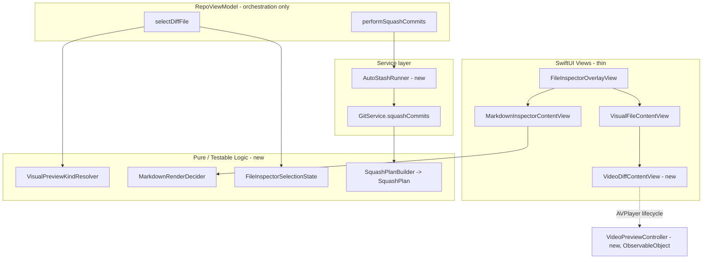
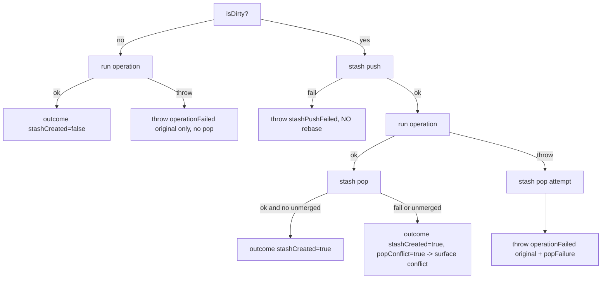

# Design Document

## Overview

本设计覆盖 requirements.md 中的五项增强，分两条主线：

- **预览面板（R1/R2/R3）**：在不把逻辑堆进 `RepoViewModel` / SwiftUI body 的前提下，新增「可视化预览类型解析」「Markdown 渲染决策」「文件切换状态机」三个可单测的纯逻辑边界，并在视图层补一个 `AVPlayer` 视频播放组件。
- **Commit Squash（R4/R5）**：把 `GitService.squashCommits` 中的「排序 + 生成 todo」抽成纯内存的 `SquashPlanBuilder` / `SquashPlan`；把「脏工作区保护」抽成服务层 `AutoStashRunner`（async），由 `performSquashCommits` 调用。

设计严格遵守 `AGENTS.md` 的 Protected Hotspots：所有新逻辑都落在独立、可测试的类型里，`RepoViewModel` 与 `GitService` 只做编排和很薄的胶水。`LazyGraphProcessor` / `CommitWalker` / 图层布局完全不动。

### 现状对照（已通过读码确认的真实符号）

| 领域 | 现有符号 | 文件 |
| --- | --- | --- |
| 图片判定 | `String.isImageFile`、`knownImageExtensions` | `Models/GitModels.swift` |
| 可视化内容 | `VisualFileContent`、`FileRenderableKind {text,image,binary}` | `Models/GitModels.swift` |
| 视觉预览视图 | `VisualFileContentView`、`ImageDiffContentView`、`BinaryFilePlaceholderView` | `Views/SourcePreviewView.swift` |
| Markdown 判定/渲染 | `String.isMarkdownFile`、`MarkdownPreviewPerformance.shouldUseRichPreview`、`richPreviewCharacterLimit=12_000`、`richPreviewLineLimit=320`、`MarkdownDocumentView`、`PlainMarkdownDocumentView`、`MarkdownInspectorContentView`（含 "Large Markdown shown as plain text"） | `Views/MarkdownPreviewView.swift` |
| 文件切换 | `selectDiffFile(_:context:ignoreSize:)`、`diffLoadGeneration`、`isFileTooLarge`、`fileTooLargeSizeMB`、`maxDiffFileSize` | `Models/RepoViewModel.swift` |
| Squash | `GitService.squashCommits(_:)`、`normalizeSquashCommitOrder(_:)`、`commitHashesOnCurrentBranch()`、`runGitWithEnv`、`runGitOutput` | `Services/GitService.swift` |
| Squash 编排 | `performSquashCommits(_:)`、`checkForRebaseConflict` | `Models/RepoViewModel.swift` |
| 冲突 | `ConflictType {.rebase,.merge,.stashApply}`、`checkForMergeOrStashConflict(errorMessage:type:)` | `Models/GitModels.swift`、`Models/RepoViewModel.swift` |
| Stash | `stashSave(message:includeUntracked:)`、`stashPop(index:)`、`hasIndexConflicts()` | `Services/GitService.swift` |

> 注意（一个对设计有影响的现状）：现有 `squashCommits` 的 sed 脚本只把「被选中且非 anchor」的行从 `pick` 改成 `squash`，**并不重排顺序**。当所选 commit 非连续（如 1..6 选 {2,5}）时，5 不会被移到 2 之后，结果与用户预期的「先 reorder 再 squash」不一致。R4 的核心就是修这个问题。

## Architecture



### 新增 / 修改类型与文件位置

| 类型 | 状态 | 文件路径 | 职责 |
| --- | --- | --- | --- |
| `String.videoExtensions` / `isVideoFile` | 新增 | `Models/GitModels.swift`（紧挨 `isImageFile`） | 视频扩展名集合与判定（R1.1） |
| `VisualPreviewKind` + `VisualPreviewKindResolver` | 新增 | `Models/VisualPreviewKind.swift` | 由 path + 大小决定 `.image/.video/.markdownRich/.markdownPlain/.binary/.tooLarge/.monaco`（纯函数） |
| `VideoPreviewController` | 新增 | `Views/Detail/VideoPreviewController.swift` | `@Observable`/`ObservableObject` 包裹 `AVPlayer`，封装 pause→detach→release（R1.5/R1.6） |
| `VideoDiffContentView` | 新增 | `Views/SourcePreviewView.swift`（同文件追加）或 `Views/Detail/VideoDiffContentView.swift` | 用 `VideoPlayer` 显示视频 + 解码失败回退占位 |
| `MarkdownRenderDecision` + `MarkdownRenderDecider` | 新增 | `Views/MarkdownPreviewView.swift`（紧挨 `MarkdownPreviewPerformance`）或 `Models/MarkdownRenderDecider.swift` | `Markdown_Render_Cap=262144` + 现有启发式 + per-file opt-in（R2） |
| `FileInspectorSelectionState` | 新增 | `Models/FileInspectorSelectionState.swift` | 封装 generation 令牌 + 状态重置 + 「payload 是否可应用」判定（R3） |
| `SquashPlan` + `SquashPlanBuilder` | 新增 | `Services/SquashPlanBuilder.swift` | 纯内存生成 rebase todo（R4.1–R4.3、R4.7） |
| `AutoStashRunner` | 新增 | `Services/AutoStashRunner.swift` | 脏树才 stash，包裹 async 操作，失败/冲突恢复（R5） |
| `FileRenderableKind` | 修改 | `Models/GitModels.swift` | 增加 `case video`（让 `VisualFileContent` 能表达视频） |
| `VisualFileContentView` | 修改 | `Views/SourcePreviewView.swift` | 在 `content.kind == .video` 时渲染 `VideoDiffContentView` |
| `GitService.squashCommits` | 修改 | `Services/GitService.swift` | 改用 `SquashPlanBuilder` + 完整 hash 的 `GIT_SEQUENCE_EDITOR` 脚本 |
| `RepoViewModel.selectDiffFile` | 修改 | `Models/RepoViewModel.swift` | too-large 早退分支也走 generation 校验；调用 `FileInspectorSelectionState` |
| `RepoViewModel.performSquashCommits` | 修改 | `Models/RepoViewModel.swift` | 用 `AutoStashRunner` 包裹 `git.squashCommits` |

## Components and Interfaces

### R1 视频预览

#### 1. 扩展名与内容类型

```swift
// GitModels.swift —— 与 isImageFile 并列
extension String {
    static let knownVideoExtensions: Set<String> = ["mp4", "m4v", "mov", "m4a"]

    var isVideoFile: Bool {
        let ext = (self as NSString).pathExtension.lowercased()
        guard !ext.isEmpty else { return false }
        if Self.knownVideoExtensions.contains(ext) { return true }
        guard let type = UTType(filenameExtension: ext) else { return false }
        return type.conforms(to: .audiovisualContent)
    }
}

enum FileRenderableKind: Sendable, Equatable {
    case text
    case image
    case video   // 新增
    case binary
}
```

`VisualFileContent` 增加便捷属性 `var isVideo: Bool { kind == .video }`。后端构造视觉内容时（`loadDiffPayload` 路径），当 `path.isVideoFile && !isImageFile` 且能拿到字节，构造 `kind: .video`。

#### 2. `VideoPreviewController`（AVPlayer 生命周期，可在视图外测试）

```swift
@MainActor
final class VideoPreviewController: ObservableObject {
    enum LoadState: Equatable { case idle, loading, ready, failed }
    @Published private(set) var state: LoadState = .idle
    private(set) var player: AVPlayer?
    private var tempURL: URL?

    func load(data: Data, fileExtension: String) { /* 写临时文件 -> AVURLAsset -> 校验 playable */ }
    func teardown() { player?.pause(); player = nil; removeTempFile() }  // pause -> detach -> release
    deinit { /* 同步 teardown 的非 actor 安全子集 */ }
}
```

- R1.2：从 `VisualFileContent.currentData`（即 `newData ?? oldData`）取字节。
- R1.3：`AVURLAsset` 的 `load(.isPlayable)` 返回 false 或抛错 → `state = .failed`，视图改渲染 `BinaryFilePlaceholderView`（title 用「Unsupported video」语义，message 不暴露内部错误码）。
- R1.5：初始 `player` 不调用 `play()`，自然停在 0（paused at time zero）。
- R1.6：teardown 顺序固定 `pause()` → 置 `player = nil`（detach/release）→ 删临时文件。`VideoDiffContentView.onDisappear` 与 `selectDiffFile`/`closeFileInspector`/切 commit 都触发 teardown。

> `state` 的状态机和 `teardown` 的副作用顺序都可在不实例化 SwiftUI body 的情况下单测（直接 new controller、喂数据、断言 `state` 与 `player == nil`）。

#### 3. 视图接线

`VisualFileContentView.body` 增加分支：

```swift
if content.isImage {
    ImageDiffContentView(...)
} else if content.isVideo {
    VideoDiffContentView(content: content, path: path)   // 内部持有 @StateObject VideoPreviewController
} else {
    BinaryFilePlaceholderView(...)
}
```

R1.7 大小守卫复用 `selectDiffFile` 既有的 `maxDiffFileSize` 早退（见 R3），视频不另开内存读取通道。

### R2 大 Markdown 渲染

#### 决策抽离

```swift
// MarkdownPreviewView.swift —— 紧挨 MarkdownPreviewPerformance
enum MarkdownPreviewPerformance {
    static let richPreviewCharacterLimit = 12_000
    static let richPreviewLineLimit = 320
    static let renderCapBytes = 262_144   // Markdown_Render_Cap, R2.1（与上面两个常量并列）
}

enum MarkdownRenderDecision: Equatable { case rich, plain }

enum MarkdownRenderDecider {
    /// forceRich: 用户对当前文件点了 opt-in
    static func decide(text: String, forceRich: Bool) -> MarkdownRenderDecision {
        if forceRich { return .rich }
        let byteCount = text.utf8.count
        if byteCount > MarkdownPreviewPerformance.renderCapBytes { return .plain }   // R2.3
        if byteCount <= MarkdownPreviewPerformance.renderCapBytes,
           MarkdownPreviewPerformance.shouldUseRichPreview(for: text) { return .rich }
        // <= cap 但触发旧行/字符启发式：R2.2 要求 <= cap 一律 rich
        return .rich
    }
}
```

R2.2 的语义：只要 UTF-8 字节 ≤ `renderCapBytes` 就走 `.rich`，**即便**旧的 `shouldUseRichPreview`（12k 字符 / 320 行）会判 false。即字节阈值是唯一硬门槛，旧启发式不再单独压制渲染。

#### per-file opt-in 与 session 作用域

`MarkdownInspectorContentView` 增加 `@State private var forceRich = false`，并按当前文件 path 重置：

```swift
.onChange(of: filePath) { _, _ in forceRich = false }   // R2.4：换文件即失效；同一文件下次 session 也重置
```

- R2.3：当 `decide(...) == .plain` 时显示常驻 "Large Markdown shown as plain text" 文案，并在其旁放一个 labeled 按钮「Render Anyway」，点击置 `forceRich = true`。
- R2.4：`forceRich` 只影响当前文件当前 session，不写任何全局默认。
- R2.5：`.rich` 仍走现有 `MarkdownDocumentView`，zoom / 链接 / 锚点行为不改。
- R2.6：渲染抛错或 5s 内无首帧 → 回退 `PlainMarkdownDocumentView`（完整内容不截断）+ 非阻塞提示。超时用 `Task` + `Task.sleep(5s)` 看门狗，首帧到达取消看门狗。
- R2.7：解码失败 / 读盘失败 → 走既有 unreadable 占位，两种 markdown 视图都不进。

> `MarkdownRenderDecider.decide` 是纯函数，R2.8 的三个边界（=cap→rich、cap+1→plain、opt-in 只翻当前文件）都在 helper 层单测，不实例化 SwiftUI body。

### R3 文件切换正确性

#### `FileInspectorSelectionState`（generation 令牌 + 重置）

```swift
struct FileInspectorSelectionState {
    private(set) var generation: Int = 0

    /// 选择新文件：递增令牌并返回本次令牌。调用方随后做同步重置。
    mutating func beginSelection() -> Int { generation += 1; return generation }

    /// 异步 payload 回来时判断是否还属于当前选择。
    func canApply(token: Int) -> Bool { token == generation }
}
```

`RepoViewModel` 把现有裸 `diffLoadGeneration: Int` 替换为该结构（或保留字段、把判定逻辑下放到该结构做单测）。`selectDiffFile` 的修改要点：

1. **R3.1 同步重置前置**：在任何 `await` / `Task.detached` 之前，于同一函数调用内把 `isFileTooLarge=false`、`fileTooLargeSizeMB=""`、`fileDiffContent=""`、`parsedDiff=nil`、`selectedDiffVisualContent=nil` 全部清掉（现状已基本如此），并新增：清理上一个选择的 `VideoPreviewController.teardown()`、清 per-file markdown `forceRich`。
2. **R3 当前 bug 根因修复**：现状 uncommitted 的 too-large 早退分支里，设了 `isFileTooLarge=true` 后 `return`，**但没有重新校验 `generation == diffLoadGeneration`**，且该分支是同步设置——真正的「点了文件但中间没切过来」来自 `FileInspectorOverlayView.inspectorContent` 只在 `fileInspectorMode == .diff` 读取 `isFileTooLarge`，而 too-large 状态由 `selectDiffFile` 设，`fileInspector*` 状态由 `openFileInspector`/`setFileInspectorMode` 设，二者在「来回切超大文件」时存在状态不同步窗口。修复：把 too-large 判定结果也纳入 generation 校验，并确保 `fileInspectorVisualContent` / `isFileTooLarge` 在同一 selection 事件里一致更新（renderable→tooLarge 与 tooLarge→renderable 都在一次事件内落地）。
3. **R3.2 / R3.6 令牌**：所有写回（成功、catch、too-large）都先 `guard state.canApply(token:)`。too-large 分支也必须过这道闸。
4. **R3.3**：too-large→too-large 时 `fileTooLargeSizeMB` 与 path 派生 label（文件名、repo 相对路径、change 状态）随新选择刷新。
5. **R3.4 / R3.5**：单次事件内完成；不渲染中间 stale 帧；占位只绑定新选择的 path/size。

#### 时序（rapid re-selection）

```mermaid
sequenceDiagram
    participant U as User
    participant VM as selectDiffFile
    participant T as Task.detached(load)
    U->>VM: select A
    VM->>VM: token=1; reset state synchronously
    VM->>T: load A (token=1)
    U->>VM: select B (before A done)
    VM->>VM: token=2; reset state synchronously
    VM->>T: load B (token=2)
    T-->>VM: A payload (token=1)
    VM->>VM: canApply(1)? 1!=2 -> discard
    T-->>VM: B payload (token=2)
    VM->>VM: canApply(2)? yes -> apply B
```

### R4 非连续 squash

#### `SquashPlan` / `SquashPlanBuilder`（纯内存）

```swift
struct SquashTodoLine: Equatable { enum Action: String { case pick, squash }; let action: Action; let hash: String }

struct SquashPlan: Equatable {
    let anchor: String                 // Anchor_Commit 完整 hash
    let todo: [SquashTodoLine]         // 顺序即写入 rebase todo 的顺序（oldest-first）
    var rebaseBase: String { anchor }  // 实际命令用 "<anchor>^"
}

enum SquashPlanError: Error, Equatable {
    case tooFewCommits(count: Int)
    case unreachable(hashes: [String])
}

enum SquashPlanBuilder {
    /// rangeOldestToNewest: 从 anchor 到 HEAD（含两端）沿 first-parent 的有序列表，oldest-first。
    /// selected: 用户选中的 hash 集合（顺序无关）。
    static func build(rangeOldestToNewest: [String], selected: Set<String>) throws -> SquashPlan
}
```

构建算法（R4.2/R4.3）：

1. `selected.count >= 2` 否则 `tooFewCommits`（R4.5 的一半，另一半 unreachable 在调用方用 `commitHashesOnCurrentBranch()` 预校验）。
2. `anchor = rangeOldestToNewest.first(where: selected.contains)`（range 已是 oldest-first，第一个命中的被选 commit 即沿 first-parent 距 HEAD 最远者）。
3. 遍历 range：
   - anchor 行 → `pick anchor`，且必须是 todo 第一行。
   - 其余被选 commit（`Squash_Set`）→ `squash`，且**全部紧跟 anchor 之后**，相对顺序保持它们在 range 中的相对顺序。
   - 未选中的 commit → `pick`，排在 squash 块之后，相对顺序保持 range 原相对顺序。
4. R4.7 自检：构建末尾断言「未选中 commit 的相对顺序 == 它们在 range 中的相对顺序」，否则 `assertionFailure`（unit test 可观测：把该不变量做成可返回校验布尔，测试直接断言）。

> 关键修正：旧实现用 `git log` newest-first 的 `dropLast()` 取 oldest，并且不重排——这里改为显式 oldest-first range + 把 `Squash_Set` 物理移动到 anchor 后，从而真正等价于「手工 reorder + s」。

#### `GitService.squashCommits` 改造

```swift
func squashCommits(_ hashes: [String]) async throws {
    let distinct = Array(NSOrderedSet(array: hashes)) as? [String] ?? hashes
    guard distinct.count >= 2 else { throw GitError.operationFailed("Need at least 2 commits to squash") }

    let reachable = await commitHashesOnCurrentBranch()
    let unreachable = distinct.filter { !reachable.contains($0) }
    guard unreachable.isEmpty else {                                  // R4.5 fail fast
        throw GitError.operationFailed("Commits not reachable from HEAD: \(unreachable.joined(separator: ", "))")
    }

    let anchor = /* oldest selected via topo-order */;
    let range = try await firstParentRange(fromAnchor: anchor)        // anchor..HEAD oldest-first, 完整 hash
    let plan = try SquashPlanBuilder.build(rangeOldestToNewest: range, selected: Set(distinct))

    let todoText = plan.todo.map { "\($0.action.rawValue) \($0.hash)" }.joined(separator: "\n") + "\n"
    // GIT_SEQUENCE_EDITOR 用脚本把 todo 文件整体覆盖为 todoText（cat > "$1"），保证 byte-for-byte（R4.4）
    try await runGitWithEnv(["rebase", "-i", "\(anchor)^"],
                            env: ["GIT_SEQUENCE_EDITOR": writePlanEditor(todoText), "GIT_EDITOR": "true"])
    invalidateRefMapCache()
}
```

R4.4：不再用 `sed` 改短 hash，而是用一个把整份 plan 写入 `$1` 的脚本（如把 plan 写临时文件，editor=`cp <tmp> "$1"`），确保 todo 内容 byte-for-byte 等于 plan，且用完整 hash 避免短 hash 冲突。

R4.6/R4.8：`git rebase` 非零退出 → 抛 `GitError.operationFailed(stderr)`；`performSquashCommits` catch 后 `loadAll()` + `checkForRebaseConflict`（已有）。成功（exit 0）→ `loadAll()` + 成功 toast，文案用 |`Squash_Set`| 表达「squashed into anchor」。

### R5 Squash 的 stash 安全包装

#### `AutoStashRunner`（服务层，async）

```swift
struct AutoStashOutcome { let stashCreated: Bool; let popConflict: Bool }

enum AutoStashError: Error {
    case stashPushFailed(String)                       // R5.3
    case operationFailed(original: String, popFailure: String?)  // R5.5
}

@MainActor
struct AutoStashRunner {
    let isDirty: () async -> Bool                       // git status --porcelain 非空
    let stashPush: () async throws -> Void              // stash push --include-untracked -m "GitN: auto-stash before squash"
    let stashPop: () async throws -> Void
    let hasUnmergedPaths: () async -> Bool              // pop 后检测冲突

    /// 包裹一次 async 操作。返回 outcome 或抛 AutoStashError。
    func run(_ operation: () async throws -> Void) async throws -> AutoStashOutcome
}
```

`run` 流程（精确对应 R5 各条）：



- R5.1：仅脏树 stash，clean 树直接跑、零 stash 条目。
- R5.2：`performSquashCommits` 无条件用 runner 包裹，脏/净判定交给 runner。
- R5.3：stash push 失败 → 不进 rebase，抛 `stashPushFailed`。
- R5.4：成功后 pop；pop 非零或留下 unmerged → `popConflict=true`，由 `performSquashCommits` 走冲突渠道。
- R5.5：操作失败且建过 stash → 尝试 pop，单一错误同时含原始失败与 pop 失败；没建 stash → 只报原始失败、不 pop。
- R5.6：pop 冲突（`hasUnmergedPaths`）→ `RepoViewModel` 路由到 `ConflictType.stashApply`（复用 `checkForMergeOrStashConflict(errorMessage:type:.stashApply)`）。
- R5.7：stash message 固定 `"GitN: auto-stash before squash"`。

#### `RepoViewModel.performSquashCommits` 改造

```swift
func performSquashCommits(_ hashes: [String]) async {
    operationInProgress = true; operationError = nil
    let runner = AutoStashRunner(/* 注入 git 闭包 */)
    do {
        let outcome = try await runner.run { try await self.git.squashCommits(hashes) }
        await loadAll()
        if outcome.popConflict {
            await checkForMergeOrStashConflict(errorMessage: "Stash pop resulted in merge conflicts", type: .stashApply)
        } else {
            showToast(title: "Squash Completed",
                      detail: "Squashed \(hashes.count - 1) commits into 1", style: .success)
        }
    } catch let AutoStashError.operationFailed(original, _) {
        await loadAll()
        await checkForRebaseConflict(errorMessage: original)       // rebase 冲突仍走原渠道
    } catch {
        await loadAll()
        showToast(title: "Squash Failed", detail: error.localizedDescription, style: .error)
    }
    operationInProgress = false
}
```

> `git status --porcelain` 当前 `GitService` 未直接暴露成单一 helper（有 libgit2 status 能力）。设计上新增一个小 helper `func hasWorkingTreeChanges() async -> Bool`（复用现有 status/`hasIndexConflicts` 同层能力），保持 `GitService` 不膨胀新职责，仅补一个查询。stash push/pop 复用现有 `stashSave(message:includeUntracked:)` / `stashPop(index:)`。

## Data Models

- `FileRenderableKind` 增加 `.video`（向后兼容：现有 `.text/.image/.binary` 全部不变，`switch` 处补 `.video` 分支）。
- `VisualFileContent` 增加 `var isVideo`。
- `SquashTodoLine` / `SquashPlan` / `SquashPlanError` 为纯值类型，`Equatable`，便于断言。
- `AutoStashOutcome` / `AutoStashError` 为纯值类型。
- `MarkdownRenderDecision` 为 `enum {rich,plain}`。

## Correctness Properties（PBT 不变量）

### SquashPlanBuilder（`SquashPlanBuilderTests`）
对任意 `rangeOldestToNewest`（去重、非空、模拟 1..N）与任意 `selected ⊆ range, |selected| >= 2`：
1. **anchor 不变式**：`plan.todo.first!.action == .pick && plan.todo.first!.hash == anchor`，且 `anchor` 是 range 中第一个属于 `selected` 的元素。
2. **squash 块连续且紧跟 anchor**：anchor 之后紧接的若干行恰为 `Squash_Set`，全部 `.squash`。
3. **squash 块内相对顺序 = range 中相对顺序**。
4. **未选 commit 相对顺序保持**：从 `plan.todo` 过滤出未选 commit，序列 == 它们在 range 中的子序列（R4.7 的可观测形式）。
5. **集合守恒**：`plan.todo` 的 hash 集合 == range 的 hash 集合，无增删。
6. **仅 Squash_Set 移动**：未选 commit 的「相对其他未选 commit」位置不变。
7. **cardinality**：`|selected| < 2` 抛 `tooFewCommits`。

### AutoStashRunner（`AutoStashRunnerTests`）
1. clean 树 → `stashPush` 调用次数 0、`stashPop` 0、`stashCreated == false`。
2. dirty 树成功 → `stashPush` 恰 1 次、`stashPop` 恰 1 次。
3. 任意路径下 `stashPop` 调用次数 ≤ `stashPush` 调用次数 ≤ 1（至多建一个、至多 pop 一次）。
4. stash push 失败 → operation 闭包 0 次执行（不进 rebase）。
5. operation 失败且 clean 树 → 不调用 pop，错误只含 original。
6. operation 失败且 dirty 树 → 调用 pop，错误同时含 original 与 pop 结果。

### FileInspectorSelectionState（`FileInspectorSelectionStateTests`）
1. `beginSelection` 严格单调递增。
2. 对任意 token 序列，`canApply(token)` 为真 ⇔ `token == 当前 generation`；任何「旧 token」payload 永不被应用（R3.2/R3.6）。
3. 连续多次 `beginSelection` 后，只有最后一次的 token 能 `canApply`。

## Error Handling

| 场景 | 触发 | 处理 | 需求 |
| --- | --- | --- | --- |
| 视频解码失败 | `AVURLAsset` not playable / load error | `VideoPreviewController.state=.failed` → 渲染 binary 占位「Unsupported video」，不暴露错误码 | R1.3 |
| 视频超大 | size > `maxDiffFileSize` | 复用 `File_Too_Large_State`，不建 `AVPlayer`、不读字节 | R1.7 |
| Markdown 渲染异常 / 5s 超时 | 渲染抛错或无首帧 | 回退 `PlainMarkdownDocumentView`（完整内容）+ 非阻塞提示 | R2.6 |
| Markdown 不可读 | 非 UTF-8 / 读盘失败 | 既有 unreadable 占位，两种 md 视图都不进 | R2.7 |
| rebase 非零退出 | `git rebase` 冲突/失败 | `GitError.operationFailed(stderr)` → `loadAll()` + `checkForRebaseConflict` | R4.6 |
| 选中 < 2 或不可达 | 预校验失败 | `GitError.operationFailed` fail fast，不 spawn rebase/不动 working tree/index/ref | R4.5 |
| stash push 失败 | `stashSave` 抛错 | `AutoStashError.stashPushFailed`，不进 rebase | R5.3 |
| pop 冲突 | pop 非零或 unmerged paths | 路由 `ConflictType.stashApply` | R5.4/R5.6 |
| 操作失败 + 已 stash | rebase 失败 | pop 尝试 + 合并错误（original + pop） | R5.5 |

## Concurrency & Cancellation

- **diffLoadGeneration 令牌**：`selectDiffFile` 入口同步 `beginSelection()`，所有异步写回（成功 / catch / too-large）前 `guard canApply(token)`。修复点：too-large 早退也必须过闸，避免旧选择把 too-large 状态写到新选择上。
- **AVPlayer teardown 顺序**：固定 `pause()` → 释放 player 引用（detach）→ 删临时文件；在切行、关闭 inspector、切 commit 三处触发；`VideoDiffContentView.onDisappear` 兜底。
- **AutoStashRunner async 边界**：`run` 内 `isDirty / stashPush / operation / stashPop / hasUnmergedPaths` 顺序 await，无并发；保证「至多一个 stash、至多一次 pop」。
- **Markdown 5s 看门狗**：`Task` + `Task.sleep`，首帧回调取消看门狗，超时切 plain。

## Test Strategy

| 组件 | 层级 | 是否实例化 SwiftUI body | 文件 |
| --- | --- | --- | --- |
| `String.isVideoFile` / `videoExtensions` | 单元 | 否 | `Tests/.../VideoExtensionTests.swift` |
| `VideoPreviewController` state + teardown | 单元（MainActor） | 否（直接 new controller） | `Tests/.../VideoPreviewControllerTests.swift` |
| `MarkdownRenderDecider.decide` | 单元 | 否 | `Tests/.../MarkdownRenderDeciderTests.swift`（或并入 `MarkdownPreviewRenderingTests`） |
| `FileInspectorSelectionState` | 单元 | 否 | `Tests/.../FileInspectorSelectionStateTests.swift` |
| `selectDiffFile` 四种过渡 + rapid re-select | view-model | 否（驱动 VM 方法，断言状态字段） | `RepoViewModelBehaviorTests.swift` 扩展 |
| `SquashPlanBuilder` 不变量 | 单元 / PBT | 否 | `Tests/.../SquashPlanBuilderTests.swift` |
| `GitService.squashCommits` 非连续 squash | service（真实临时 repo） | 否 | `GitServiceBehaviorTests.swift` 扩展 |
| `AutoStashRunner` 五条路径 | service（注入闭包 mock） | 否 | `Tests/.../AutoStashRunnerTests.swift` |

测试约定沿用现有 `TemporaryGitRepository`（service 层真 repo）与 `RepoViewModelBehaviorTests` / `DiffContentLogicTests`（VM 层）模式。所有新纯逻辑类型的测试都不实例化 SwiftUI body（满足 R1.8 / R2.8 / R3.7 / R4.9 / R5.8）。

## Migration / Backward-Compat Notes

- `FileRenderableKind` 加 `.video` 后，需在所有 `switch kind` 处补分支（`VisualFileContentView` 等）；现有 image/binary 路径行为不变。
- `selectDiffFile` 签名不变（仍 `(_:context:ignoreSize:)`），仅内部状态管理替换为 `FileInspectorSelectionState` 并修复 too-large 早退闸门；现有调用点（含 `RepoViewModel.swift:2977` 的 size 守卫调用）无需改。
- `MarkdownInspectorContentView` 对外签名不变，仅新增 `forceRich` 内部状态与 opt-in 按钮；`richPreviewCharacterLimit/LineLimit` 保留，新增 `renderCapBytes` 与其并列。
- `GitService.squashCommits` 对外签名不变（`func squashCommits(_ hashes: [String]) async throws`），调用点 `performSquashCommits` 行为增强（stash 包装），不破坏既有单 commit 拒绝（< 2 抛错）。
- `normalizeSquashCommitOrder` 的语义被 `SquashPlanBuilder` + 显式 first-parent range 取代；可保留为内部 helper 或在确认无其他调用方后移除（先保留，降低风险）。
- `performSquashCommits` 成功 toast 文案从「Successfully squashed N commits」调整为「Squashed N-1 commits into 1」，与 R4.8 的 |`Squash_Set`| 语义一致；现有期望该 toast 的测试需同步更新（若有）。
