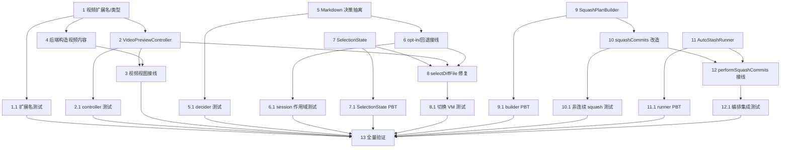

# Implementation Plan

## Overview

本计划把设计拆成可独立执行、可测试的任务，分两条主线：预览面板（R1/R2/R3）与 Commit Squash（R4/R5），最后一个全量验证任务收尾。约定：

- 每个任务先写/更新测试，再实现，最后跑 `swift test` 验证（项目用 SwiftPM，测试在 `GitN/Tests/GitNTests`）。
- 纯逻辑类型的测试不实例化 SwiftUI body（满足 R1.8 / R2.8 / R3.7 / R4.9 / R5.8）。
- `[PBT]` 标记的子任务为属性测试（property-based）。
- 不改 `LazyGraphProcessor` / `CommitWalker` / 图层布局；新增逻辑放独立类型，`RepoViewModel` / `GitService` 只做编排。

## Tasks

- [x] 1. 视频扩展名与内容类型基础设施
  - 在 `Models/GitModels.swift` 中紧挨 `isImageFile` 新增 `String.knownVideoExtensions`（`mp4/m4v/mov/m4a`）与 `var isVideoFile`（小写、去前导点、大小写不敏感，UTType 兜底 `audiovisualContent`）
  - 在 `FileRenderableKind` 增加 `case video`，给 `VisualFileContent` 加 `var isVideo`
  - 补齐所有 `switch kind` 处的 `.video` 分支，保证现有 image/binary/text 行为不变
  - _Requirements: 1.1_

- [x] 1.1 视频扩展名单元测试
  - 在 `Tests/GitNTests/VideoExtensionTests.swift` 覆盖：四个必需扩展名命中、大小写不敏感命中（`Clip.MP4`）、至少一个非视频扩展名被拒（`a.txt`/`a.png`）、无扩展名返回 false
  - 不实例化 SwiftUI body
  - _Requirements: 1.1, 1.8_

- [x] 2. `VideoPreviewController`（AVPlayer 生命周期）
  - 新增 `Views/Detail/VideoPreviewController.swift`：`@MainActor`、`ObservableObject`，`LoadState {idle,loading,ready,failed}`
  - `load(data:fileExtension:)`：写临时文件 → `AVURLAsset` → 校验 `.isPlayable`，失败置 `.failed`（R1.3）
  - `teardown()`：固定顺序 `pause()` → 释放 `player`（detach/release）→ 删临时文件（R1.6）；`deinit` 兜底
  - 初始不调用 `play()`，停在 time zero（R1.5）
  - _Requirements: 1.3, 1.5, 1.6_

- [x] 2.1 `VideoPreviewController` 单元测试
  - 在 `Tests/GitNTests/VideoPreviewControllerTests.swift`：喂可解码数据断言 `state==.ready`；喂垃圾字节断言 `state==.failed`；调用 `teardown()` 后断言 `player==nil` 且临时文件已删
  - 直接 new controller，不实例化 SwiftUI body
  - _Requirements: 1.3, 1.5, 1.6, 1.8_

- [x] 3. 视频预览视图接线
  - 新增 `VideoDiffContentView`（持有 `@StateObject VideoPreviewController`）：`.ready` 用 `VideoPlayer` 显示 + transport（play/pause、scrub、current/duration，R1.4）；`.failed` 渲染 `BinaryFilePlaceholderView`（「Unsupported video」语义，不暴露错误码）
  - 在 `VisualFileContentView.body` 增加 `content.isVideo` 分支
  - `onDisappear` 调用 `controller.teardown()` 兜底
  - _Requirements: 1.2, 1.3, 1.4, 1.6_

- [x] 4. 后端视觉内容构造支持视频
  - 在 `loadDiffPayload` 视觉内容判定处：当 `path.isVideoFile && !path.isImageFile` 且能取字节时构造 `VisualFileContent(kind: .video, ...)`，字节取 `newData ?? oldData`（deletion 用 oldData）
  - _Requirements: 1.2_

- [x] 5. Markdown 渲染决策抽离
  - 在 `Views/MarkdownPreviewView.swift` 的 `MarkdownPreviewPerformance` 中新增 `static let renderCapBytes = 262_144`（与 `richPreviewCharacterLimit`/`richPreviewLineLimit` 并列，R2.1）
  - 新增 `enum MarkdownRenderDecision {rich,plain}` 与 `enum MarkdownRenderDecider { static func decide(text:forceRich:) }`：`forceRich` 优先；`utf8.count <= renderCapBytes` 一律 `.rich`（即便旧启发式判 false，R2.2）；`> cap` 为 `.plain`（R2.3）
  - _Requirements: 2.1, 2.2, 2.3_

- [x] 5.1 `MarkdownRenderDecider` 单元测试
  - 在 `Tests/GitNTests/MarkdownRenderDeciderTests.swift`（或并入 `MarkdownPreviewRenderingTests.swift`）：=cap → rich；cap+1 byte → plain；`forceRich=true` 对超 cap 文件 → rich；构造一个超旧字符/行启发式但 ≤cap 的文本 → rich
  - 不实例化 SwiftUI body
  - _Requirements: 2.2, 2.3, 2.8_

- [x] 6. Markdown per-file opt-in 与回退接线
  - `MarkdownInspectorContentView` 用 `MarkdownRenderDecider.decide(...)` 替换裸 `usesRichPreview`；新增 `@State private var forceRich`，`.onChange(of: filePath)` 重置（换文件/新 session 失效，R2.4）
  - 当决策为 `.plain`：保留常驻 "Large Markdown shown as plain text"，旁加 labeled 「Render Anyway」按钮置 `forceRich=true`（R2.3）
  - rich 渲染抛错或 5s 无首帧 → 看门狗回退 `PlainMarkdownDocumentView`（完整内容）+ 非阻塞提示（R2.6）
  - 解码/读盘失败 → 走既有 unreadable 占位（R2.7）；保留 zoom/链接/锚点行为（R2.5）
  - _Requirements: 2.3, 2.4, 2.5, 2.6, 2.7_

- [x] 6.1 opt-in session 作用域测试
  - 验证：单个超 cap 文件 opt-in 只翻该文件决策；同 session 第二个超 cap 文件仍 `.plain`（在 `MarkdownRenderDecider` 层 + per-file flag 层断言）
  - _Requirements: 2.4, 2.8_

- [x] 7. `FileInspectorSelectionState` 抽离
  - 新增 `Models/FileInspectorSelectionState.swift`：`generation` 单调递增、`mutating func beginSelection() -> Int`、`func canApply(token:) -> Bool`
  - _Requirements: 3.2_

- [x] 7.1 `FileInspectorSelectionState` 单元测试 `[PBT]`
  - 在 `Tests/GitNTests/FileInspectorSelectionStateTests.swift`：
    - `beginSelection` 严格单调递增
    - `[PBT]` 对任意 token 序列：`canApply(token)` 为真 ⇔ `token == 当前 generation`；任意旧 token 永不可应用
    - 连续多次 `beginSelection` 后只有最后一次 token 可应用
  - _Requirements: 3.2, 3.6, 3.7_

- [x] 8. `selectDiffFile` 切换正确性修复
  - 将裸 `diffLoadGeneration` 替换为 `FileInspectorSelectionState`（或把判定下放给它）
  - **修复 too-large 早退闸门**：uncommitted size 早退分支也必须 `guard canApply(token)` 后再写 `isFileTooLarge/fileTooLargeSizeMB`，避免旧选择污染新选择（R3 核心 bug）
  - 同步重置前置：进入函数即清 `isFileTooLarge/fileTooLargeSizeMB/fileDiffContent/parsedDiff/selectedDiffVisualContent`，并 teardown 上一个 `VideoPreviewController`、清 per-file markdown `forceRich`（R3.1）
  - too-large↔too-large 时刷新 size 与 path 派生 label（文件名/repo 相对路径/change 状态，R3.3）
  - 保证 tooLarge→renderable 与 renderable→tooLarge 在单次 selection 事件内一致落地，无中间 stale 帧/无内容泄漏（R3.4/R3.5）
  - _Requirements: 3.1, 3.2, 3.3, 3.4, 3.5, 3.6_

- [x] 8.1 文件切换 view-model 测试
  - 在 `RepoViewModelBehaviorTests.swift` 扩展：驱动 `selectDiffFile` 覆盖四种过渡（TooLarge→TooLarge、TooLarge→renderable、renderable→TooLarge、renderable→renderable）+ rapid re-select（第二次选择先于第一次 load 完成）
  - 每个用例断言 `isFileTooLarge`、`fileTooLargeSizeMB`、active preview kind、displayed path
  - 不实例化 SwiftUI body（驱动 VM 方法、断言状态字段）
  - _Requirements: 3.3, 3.4, 3.5, 3.6, 3.7_

- [x] 9. `SquashPlan` / `SquashPlanBuilder`（纯内存）
  - 新增 `Services/SquashPlanBuilder.swift`：`SquashTodoLine{action:.pick/.squash, hash}`、`SquashPlan{anchor, todo}`、`SquashPlanError{tooFewCommits, unreachable}`
  - `build(rangeOldestToNewest:selected:)`：anchor = range 中首个被选 commit；anchor 行为首行 `pick`；`Squash_Set` 全部紧跟 anchor 标 `squash`（保持 range 内相对顺序）；未选 commit 排后、保持相对顺序、标 `pick`；`|selected|<2` 抛 `tooFewCommits`
  - 构建末尾做 R4.7 自检（未选 commit 相对顺序不变），暴露为可测试的校验结果
  - 不 spawn 子进程、不读写磁盘、不设 `GIT_SEQUENCE_EDITOR`
  - _Requirements: 4.1, 4.2, 4.3, 4.7_

- [x] 9.1 `SquashPlanBuilder` 不变量测试 `[PBT]`
  - 在 `Tests/GitNTests/SquashPlanBuilderTests.swift`：
    - 固定用例：连续选择、非连续 {2,5} of 1..6（HEAD=6）、全范围选择、`|selected|<2` 抛错
    - `[PBT]` 对任意 range(模拟 1..N)+任意 `selected(|.|>=2)`：anchor 不变式、squash 块连续紧跟 anchor、squash 块内相对顺序、未选 commit 相对顺序保持、hash 集合守恒、仅 Squash_Set 移动
  - 不实例化 SwiftUI body
  - _Requirements: 4.2, 4.3, 4.7, 4.9_

- [x] 10. `GitService.squashCommits` 改造
  - 预校验：去重后 `<2` 抛 `GitError.operationFailed`；用 `commitHashesOnCurrentBranch()` 找不可达 hash，非空则 fail fast 且不 spawn rebase/不动 working tree/index/ref（R4.5）
  - 计算 anchor（topo-order 最老被选）+ 取 `anchor..HEAD` first-parent oldest-first 完整 hash range
  - 调 `SquashPlanBuilder.build`，把 plan 写成完整 hash 的 todo 文本，`GIT_SEQUENCE_EDITOR` 用「整体覆盖 `$1`」脚本保证 byte-for-byte（替代旧 sed，R4.4）；`GIT_EDITOR=true`
  - rebase 非零退出 → 抛 `GitError.operationFailed(stderr)`（R4.6）
  - _Requirements: 4.4, 4.5, 4.6_

- [x] 10.1 非连续 squash service 测试
  - 在 `GitServiceBehaviorTests.swift` 用 `TemporaryGitRepository` 构造 1..6，选 {2,5} squash，断言结果等价于「reorder + s」（最终历史、commit 数、内容）；补不可达 hash 拒绝与 `<2` 拒绝
  - _Requirements: 4.4, 4.5, 4.6, 4.9_

- [x] 11. `AutoStashRunner`（服务层 stash 包装）
  - 新增 `Services/AutoStashRunner.swift`：注入 `isDirty/stashPush/stashPop/hasUnmergedPaths` 闭包；`run(_:)` 返回 `AutoStashOutcome{stashCreated,popConflict}` 或抛 `AutoStashError{stashPushFailed, operationFailed(original,popFailure)}`
  - 逻辑：clean→直接跑零 stash（R5.1）；dirty→push（失败抛 `stashPushFailed` 不进操作，R5.3）→ 跑操作 → 成功 pop（冲突标 `popConflict`，R5.4）/ 失败则 pop 尝试 + 合并错误（R5.5）
  - 新增 `GitService.hasWorkingTreeChanges() async -> Bool`（`git status --porcelain` 非空，复用现有 status 能力，不膨胀新职责）；stash 复用 `stashSave(message:"GitN: auto-stash before squash", includeUntracked:true)` / `stashPop`（R5.7）
  - _Requirements: 5.1, 5.3, 5.4, 5.5, 5.7_

- [x] 11.1 `AutoStashRunner` 测试 `[PBT]`
  - 在 `Tests/GitNTests/AutoStashRunnerTests.swift`（注入 mock 闭包）：clean（0 push/0 pop）、dirty 成功（1 push/1 pop）、dirty 成功但 pop 冲突（标 popConflict）、dirty 操作失败已 stash（合并错误 + 尝试 pop）、dirty 但 stash push 失败（操作 0 次执行）
  - `[PBT]` 任意路径下 `pop 次数 ≤ push 次数 ≤ 1`
  - _Requirements: 5.1, 5.3, 5.4, 5.5, 5.8_

- [x] 12. `performSquashCommits` 接线 stash 包装与冲突路由
  - 用 `AutoStashRunner.run { try await git.squashCommits(hashes) }` 包裹（无条件包裹，脏净判定交给 runner，R5.2）
  - 成功且无 popConflict → `loadAll()` + 成功 toast（文案按 R4.8：squashed |Squash_Set| into 1）
  - popConflict → `loadAll()` + `checkForMergeOrStashConflict(type:.stashApply)`（R5.6）
  - `AutoStashError.operationFailed` → `loadAll()` + `checkForRebaseConflict`（rebase 冲突仍走原渠道，R4.6）
  - _Requirements: 4.6, 4.8, 5.2, 5.6_

- [x] 12.1 squash 编排集成测试
  - 在 `RepoViewModelBehaviorTests.swift` 用真实临时 repo：脏树非连续 squash 成功后工作区改动恢复（stash pop）；clean 树 squash 不产生残留 stash 条目；成功 toast 文案符合 R4.8
  - _Requirements: 4.8, 5.2_

- [x] 13. 全量验证与回归
  - 跑 `swift test`（含新增 PBT），修复回归；确认现有 `DiffContentLogicTests` / `DiffFileRowModelTests` / `MarkdownPreviewRenderingTests` / `GitServiceBehaviorTests` 仍通过
  - 同步更新任何依赖旧 squash toast 文案的测试
  - 清理临时文件、确认无新增编译警告
  - _Requirements: 1.8, 2.8, 3.7, 4.9, 5.8_

## Task Dependency Graph



```json
{
  "tasks": [
    { "id": "1", "dependsOn": [] },
    { "id": "1.1", "dependsOn": ["1"] },
    { "id": "2", "dependsOn": ["1"] },
    { "id": "2.1", "dependsOn": ["2"] },
    { "id": "3", "dependsOn": ["2", "4"] },
    { "id": "4", "dependsOn": ["1"] },
    { "id": "5", "dependsOn": [] },
    { "id": "5.1", "dependsOn": ["5"] },
    { "id": "6", "dependsOn": ["5"] },
    { "id": "6.1", "dependsOn": ["6"] },
    { "id": "7", "dependsOn": [] },
    { "id": "7.1", "dependsOn": ["7"] },
    { "id": "8", "dependsOn": ["7", "2", "6"] },
    { "id": "8.1", "dependsOn": ["8"] },
    { "id": "9", "dependsOn": [] },
    { "id": "9.1", "dependsOn": ["9"] },
    { "id": "10", "dependsOn": ["9"] },
    { "id": "10.1", "dependsOn": ["10"] },
    { "id": "11", "dependsOn": [] },
    { "id": "11.1", "dependsOn": ["11"] },
    { "id": "12", "dependsOn": ["10", "11"] },
    { "id": "12.1", "dependsOn": ["12"] },
    { "id": "13", "dependsOn": ["1.1", "2.1", "3", "5.1", "6.1", "7.1", "8.1", "9.1", "10.1", "11.1", "12.1"] }
  ],
  "waves": [
    { "wave": 1, "tasks": ["1", "5", "7", "9", "11"] },
    { "wave": 2, "tasks": ["1.1", "2", "4", "5.1", "6", "7.1", "9.1", "10", "11.1"] },
    { "wave": 3, "tasks": ["2.1", "3", "6.1", "8", "10.1", "12"] },
    { "wave": 4, "tasks": ["8.1", "12.1"] },
    { "wave": 5, "tasks": ["13"] }
  ]
}
```

## Notes

- 测试约定沿用现有 `TemporaryGitRepository`（service 层真 repo）与 `RepoViewModelBehaviorTests` / `DiffContentLogicTests`（VM 层）模式。
- `FileRenderableKind` 加 `.video` 后需补齐所有 `switch kind` 分支；现有 image/binary/text 行为不变。
- `GitService.squashCommits` 对外签名不变；旧 `sed` + 短 hash 逻辑被 `SquashPlanBuilder` + 完整 hash 的整体覆盖脚本取代。
- 待确认项：R4.8 成功 toast 文案当前定为「squashed N-1 commits into 1」（任务 12/13）。若需保留旧文案「squashed N commits」，在执行任务 12 前告知即可调整。
- 所有新纯逻辑类型（`MarkdownRenderDecider`、`FileInspectorSelectionState`、`SquashPlanBuilder`、`AutoStashRunner`、`VideoPreviewController`）的测试均不实例化 SwiftUI body。
